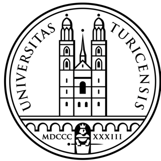

## About Me

I am a Ph.D. candidate at [TU Wien](https://www.tuwien.at/en/), supervised by [Guillaume Bellec](https://guillaume.bellec.eu/).

I'm interested in how learning works in brains and in machines, from decoding speech from neural recordings to training networks with biologically plausible learning rules.

## Education

<ul class="edu">
  <li>
    
    <strong>TU Wien</strong>Ph.D. Candidate, AI in Neuroscience
  </li>
  <li>
    
      
      
    
    <strong>ETH Zürich &amp; University of Zürich</strong>Joint M.Sc. in Neural Systems and Computation
  </li>
  <li>
    
    <strong>Purdue University</strong>B.Sc. in Computer Engineering
  </li>
</ul>



## Teaching

<ul class="cv-list">
  <li>
    
<strong>ECE 20875: Python for Data Science</strong>Jan. 2023 – Dec. 2023

    Undergraduate Teaching Assistant, Purdue University
  </li>
  <li>
    
<strong>ECE 264: Advanced C Programming</strong>Aug. 2022 – Dec. 2023

    Undergraduate Teaching Assistant, Purdue University
  </li>
</ul>

## Awards

<ul class="cv-list">
  <li>
    
<strong>Dave &amp; Marsha Meyer Undergraduate Teaching Award</strong>2023

    Purdue University
  </li>
</ul>
